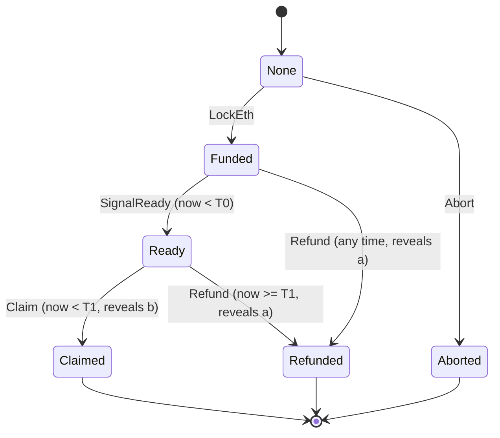

# State machine

The model follows the contract states in [11 Monero connection](https://github.com/HashChainL0/protocol-spec/blob/main/docs/11-connection-monero.md): `None`, `Funded`, `Ready`, `Claimed`, `Refunded`. It adds one state, `Aborted`, for a swap dropped after terms are agreed but before anything is locked. The spec says nothing is at stake in that case.

Two roles, named as in the spec: the ETH holder (secret `a`, point `A`) and the XMR holder (secret `b`, point `B`). `T0` and `T1` are measured from the moment the ETH is locked.

## Both directions

The swap runs in two directions. The state machine is the same in both, and roles are explicit:

- The ETH holder always locks first. The XMR holder always locks second.
- `eth-to-xmr`: the user holds ETH, so the user is the ETH holder and locks first. The operator holds XMR, is the XMR holder, and locks second.
- `xmr-to-eth`: the user holds XMR, so the user is the XMR holder and locks second. The operator holds ETH, is the ETH holder, and locks first.

`directionInfo(direction)` returns this mapping and `partyOf(direction, role)` returns `user` or `operator`. A scenario carries an optional `direction`, which only changes the labels in its notes and the party names in the funds report. Traces of the same scenario in both directions are identical.

Who has funds locked, and for how long, depends on the role and not on the direction:

| Case | Locked and for how long |
| --- | --- |
| Happy path | ETH from the ETH lock to the claim. XMR from the XMR lock to the sweep |
| Second locker never locks | Only the ETH, for as long as the ETH holder waits. In `Funded` it can refund at any time |
| Both locked, ETH holder stalls (free option) | The XMR, until the ETH holder chooses to refund. The XMR holder cannot recover before `a` is public |
| Ready, XMR holder never claims | The ETH, until `T1`, then refund |

The free option is the main griefing shape: the ETH holder, who locks first, can hold the XMR holder's funds locked for as long as it likes. In `eth-to-xmr` that is a user holding the operator's XMR, and in `xmr-to-eth` it is the operator holding the user's XMR. The spec has no bond for this, see [PARAMETERS.md](PARAMETERS.md).

`directionScenarios(direction)` returns `happy-path`, `refund`, `grief-abandoned-lock`, `grief-free-option` and `grief-no-claim`. `fundsLocked(result)` reads who had funds locked and for how long from a trace, and `summarizeOutcome(result)` says who ends with what. Run `npm run example:xmr-to-eth` or `npm run example:eth-to-xmr`.

## Diagram

## Transitions

`transition(state, event, now)` returns `{ ok: true, state }` or `{ ok: false, error }`. It never throws for an invalid event and never mutates its input. `now` is contract time in seconds and may not go backwards.

| From | Event | By | Condition | To | Effect |
| --- | --- | --- | --- | --- | --- |
| None | Abort | either | none | Aborted | none |
| None | LockEth | ETH holder | none | Funded | T0 and T1 set from `now` |
| Funded | LockXmr | XMR holder | XMR not yet locked | Funded | XMR status Locked |
| Funded, Ready | ObserveXmrConfirmations | Monero observer | XMR locked, count does not decrease | same | Confirmed at `requiredConfirmations` |
| Funded, Ready | XmrLockLost | Monero observer | XMR locked | same | reorg, XMR status NotLocked |
| Funded | SignalReady | ETH holder | `now < T0` | Ready | flag set if the lock is not Confirmed |
| Ready | Claim | XMR holder | `now < T1`, or `lateClaimAllowed` | Claimed | `b` public. The simulator flags it unsafe inside the claim safety margin |
| Funded | Refund | ETH holder | none | Refunded | `a` public |
| Ready | Refund | ETH holder | `now >= T1` | Refunded | `a` public |
| Claimed | SweepXmr | ETH holder | `b` public, XMR lock Confirmed | Claimed | XMR status SweptByEthHolder |
| Refunded | RecoverXmr | XMR holder | `a` public, XMR lock Confirmed | Refunded | XMR status RecoveredByXmrHolder |

Every other combination of phase and event is rejected with `INVALID_PHASE`. The tests enumerate all of them.

## Error codes

| Code | Meaning |
| --- | --- |
| INVALID_PHASE | The event is not allowed in the current state |
| WRONG_ACTOR | The role in `by` may not perform this event |
| DEADLINE_PASSED | `SignalReady` at or after T0, or `Claim` at or after T1 |
| DEADLINE_NOT_REACHED | `Refund` from Ready before T1 |
| INVALID_XMR_STATE | The Monero side does not allow it, for example a second `LockXmr` or a sweep with no lock |
| XMR_NOT_SPENDABLE | The lock exists but has fewer than `requiredConfirmations` |
| SECRET_NOT_REVEALED | A sweep or recovery was tried before the needed secret was public |
| CLOCK_REGRESSION | `now` is earlier than the previous event |
| INVALID_ARGUMENT | Malformed event data or time |

## Modelling choices

- **Ready on a bad lock is accepted.** The contract cannot see Monero. `SignalReady` succeeds without a confirmed XMR lock and sets `readyWithoutConfirmedLock`. This is the main user-side risk in the spec, and the wallet is responsible for checking. The model keeps the failure visible: the later `SweepXmr` is rejected.
- **Late claim.** Rule 3 says the XMR holder claims "until T1". Rule 4 says that after T1 "whichever valid action reaches the contract first wins". These read differently. The default is the strict reading (`lateClaimAllowed: false`). Set it to `true` to model the other. Worth settling in the spec.
- **Punish.** The spec has no bond or penalty. The path usually called punish in other adaptor-signature swaps maps here to a Ready swap that times out: the XMR holder does not claim before T1, the ETH holder refunds, `a` becomes public, and the XMR holder recovers their own XMR. The cost to the offender is a failed swap and delay. Griefing and bonds are an open question in the spec.
- **Monero events are inputs.** Lock, confirmations and reorgs are observations, not things the model can cause. `ObserveXmrConfirmations` and `XmrLockLost` stand in for a wallet watching the chain.
- **Secrets are flags.** The model tracks whether `a` or `b` is public, not their values. No cryptography runs here.
- **Claim safety.** A claim close to `T1` can land late, be rejected, and still show `b`. The state machine rejects a late claim as usual. The simulator adds a `claimSafety` classification to every claim, an `unsafeClaimSteps` list and a `bExposed` flag. See [CLAIM-SAFETY.md](CLAIM-SAFETY.md).
- **Exposed b is an input to the outcome, not a transition.** After a leaked `b` and a refund the ETH holder could sweep the XMR with `a` and `b`. `SweepXmr` stays limited to `Claimed`, and `summarizeOutcome` reports the both sides result from the flags.
- **Claim route.** A scenario may set `claimRoute` to `self`, `self-with-gas-drip` or `relayed-by-counterparty`. Only the last changes the outcome summary: the counterparty held `b` before any claim was public.
